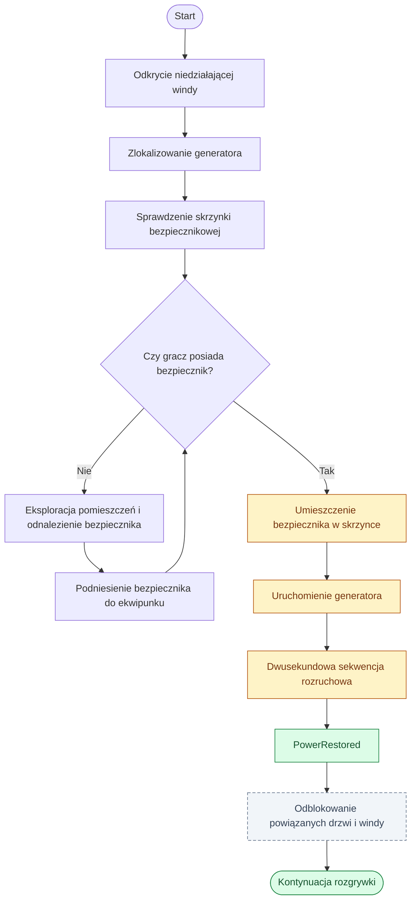
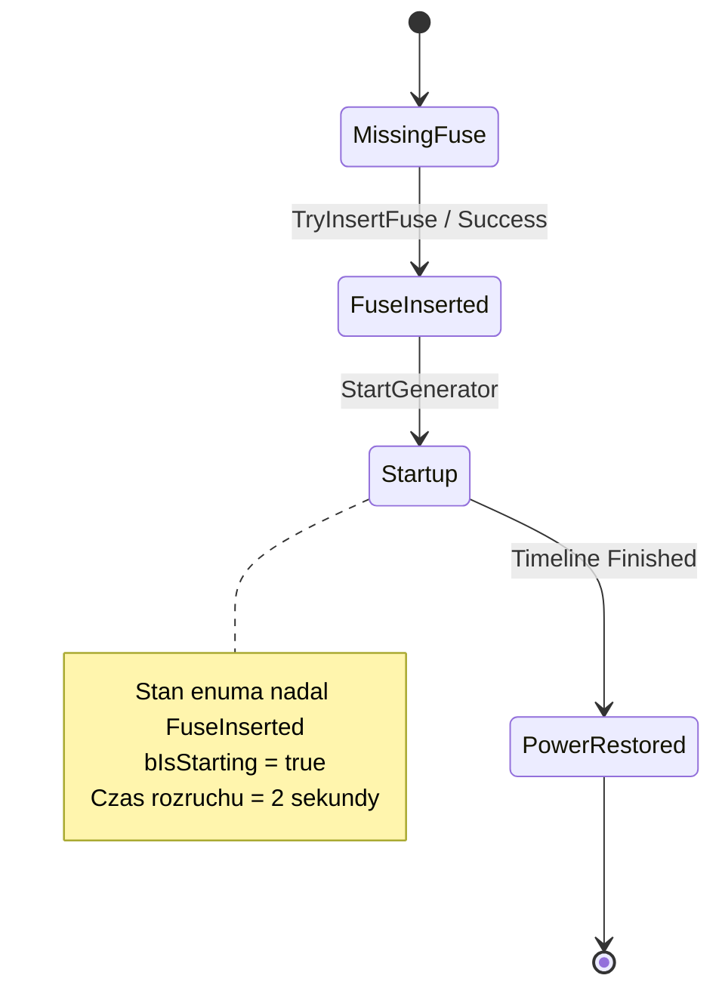
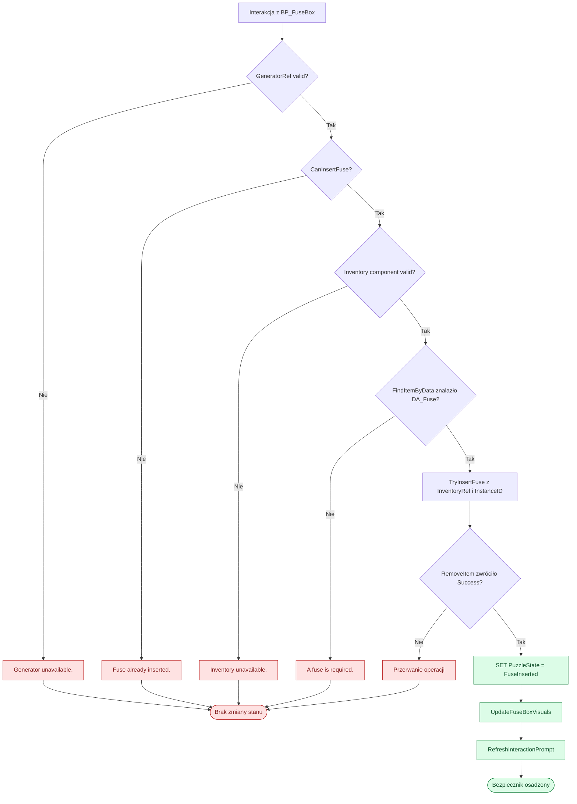
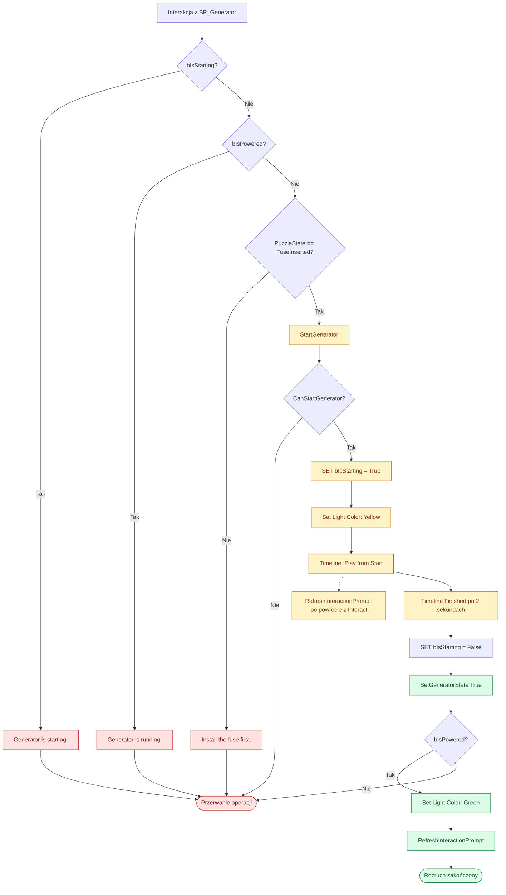
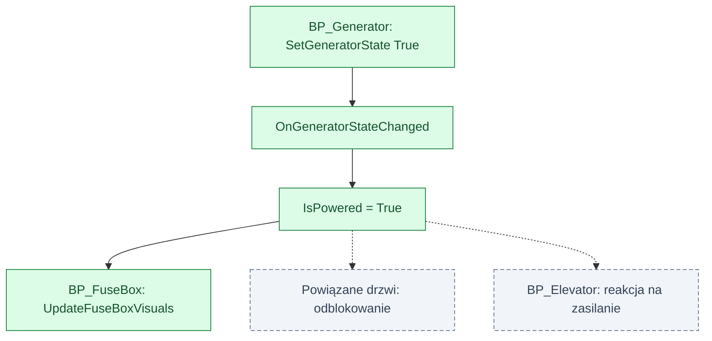

# CRYSTALBORNE | Generator Power Restoration Puzzle

Dokumentacja projektowa i techniczna zagadki przywrócenia zasilania w kopalni.

| Informacja | Wartość |
| --- | --- |
| Epic | E09 |
| Zakres | MVP / Vertical Slice |
| Silnik | Unreal Engine, Blueprint only |
| Wersja dokumentacji | 1.0 |
| Aktualizacja | 2026-11-27 |

## 1. Cel i główny przebieg zagadki

Gracz musi przywrócić zasilanie infrastruktury kopalni, aby odblokować dalszą drogę. W tym celu odnajduje bezpiecznik, umieszcza go w skrzynce bezpiecznikowej i uruchamia generator. Po zakończeniu rozruchu generator przekazuje informację o przywróceniu zasilania do powiązanych obiektów.



Kolejność odkrywania windy, generatora i skrzynki jest proponowanym przebiegiem rozgrywki, a nie wymuszoną sekwencją. Gracz może wcześniej odnaleźć bezpiecznik. Obowiązkowa jest natomiast kolejność osadzenia bezpiecznika, uruchomienia generatora i zakończenia rozruchu.

Planowana integracja z drzwiami i windą została oznaczona przerywaną ramką. Jej pełne działanie wymaga jeszcze weryfikacji.

## 2. Stany zagadki

`BP_Generator` przechowuje stan zagadki w `E_PuzzleState`. Rozruch jest stanem przejściowym kontrolowanym przez flagę `bIsStarting`, a nie dodatkową wartością enuma.



| Etap | `PuzzleState` | `bIsPowered` | `bIsStarting` |
| --- | --- | --- | --- |
| Brak bezpiecznika | `MissingFuse` | False | False |
| Bezpiecznik osadzony | `FuseInserted` | False | False |
| Rozruch | `FuseInserted` | False | True |
| Przywrócone zasilanie | `PowerRestored` | True | False |

W MVP przejścia są jednokierunkowe. Po zakończeniu rozruchu gracz nie może ponownie uruchomić ani wyłączyć generatora za pomocą tej samej interakcji. Końcowy stan na diagramie oznacza zakończenie zagadki, a nie zniszczenie aktora.

## 3. Odpowiedzialność komponentów

| Element | Odpowiedzialność |
| --- | --- |
| `BP_Generator` | Stan zagadki, walidacja startu, zużycie bezpiecznika, rozruch, broadcast stanu zasilania |
| `BP_FuseBox` | Interakcja ze skrzynką, identyfikacja wymaganego przedmiotu, feedback i wizualizacja osadzonego bezpiecznika |
| `BP_InventoryComponent` | Wyszukiwanie i usuwanie przedmiotów, aktualizacja zajętych pól ekwipunku |
| `BP_PlayerInteractionComponent` | Wywołanie interakcji i odświeżanie promptu HUD |
| `BPI_Interactable` | Wspólny kontrakt interakcji, w tym `CanInteract`, `Interact` i `GetInteractionText` |
| `DA_Fuse` | Dane bezpiecznika oraz jego właściwości questowe |
| `WBP_InventoryItem` | Oznaczenie przedmiotu questowego na podstawie `bIsQuestItem` |
| `BP_Elevator` | Docelowa reakcja na przywrócenie zasilania, do weryfikacji |
| Powiązane drzwi | Planowana reakcja na przywrócenie zasilania |
| Terminal awarii | Planowany komunikat informujący gracza o problemie z zasilaniem |

## 4. Logika umieszczania bezpiecznika

### 4.1. Walidacja i wykonanie interakcji



Diagram przedstawia łączny przepływ walidacji `CanInteract` oraz wykonania `Interact` i `TryInsertFuse`, a nie pojedynczy Blueprint Graph. `TryInsertFuse` ponownie sprawdza poprawność komponentu ekwipunku i możliwość osadzenia bezpiecznika przed jego usunięciem.

### 4.2. Kontrakt operacji

- `RequiredItemData` wskazuje na `DA_Fuse`.
- `FindItemByData(RequiredItemData)` zwraca `Found` oraz `FoundInstanceID`.
- `TryInsertFuse(InventoryRef, FuseInstanceID)` zwraca `Success`.
- `RemoveItem(InstanceID)` usuwa przedmiot i zwalnia zajęte pola ekwipunku.
- `PuzzleState` zmienia się na `FuseInserted` dopiero po uzyskaniu `Success = True` z `RemoveItem`.
- Nieudana interakcja nie może zużyć niewłaściwego przedmiotu ani zmienić stanu zagadki.
- Ponowna próba osadzenia bezpiecznika jest blokowana przez `CanInsertFuse`.

### 4.3. Konfiguracja przedmiotu questowego

| Pole | Wartość |
| --- | --- |
| Data Asset | `DA_Fuse` |
| `ItemID` | `fuse_basic` |
| `DisplayName` | `Fuse` |
| `ItemDefinition.Category` | `Quest` |
| `ItemDefinition.Width` | 2 |
| `ItemDefinition.Height` | 3 |
| `ItemDefinition.bCanRotate` | True |
| `ItemDefinition.bIsQuestItem` | True |
| `ItemDefinition.bCanDrop` | False |

Podstawowe dane przedmiotu (`ItemID`, `DisplayName`, `Description`, `Icon`) znajdują się w `PDA_ItemBase`. `F_ItemDefinition` przechowuje właściwości ekwipunku, bez powielania tych pól.

Bezpiecznik jest oznaczony złotym wykrzyknikiem w `WBP_InventoryItem`. Nie można go ręcznie wyrzucić, ale można go zużyć w dedykowanej interakcji fabularnej. W MVP nie ma osobnego systemu odzyskiwania utraconych przedmiotów questowych.

## 5. Logika uruchamiania generatora

### 5.1. Warunki uruchomienia

`CanStartGenerator` zwraca True wyłącznie wtedy, gdy wszystkie warunki są spełnione:

```text
PuzzleState == FuseInserted
AND NOT bIsPowered
AND NOT bIsStarting
```

### 5.2. Przebieg rozruchu



### 5.3. Zasady implementacyjne

- `Event Interact` wywołuje `StartGenerator`, a nie bezpośrednio `SetGeneratorState`.
- Timeline uruchamia się przez `Play from Start`, bez zapętlenia.
- Stan zasilania jest aktualizowany przez pin `Finished`, nie `Update`.
- `bIsStarting` jest ustawiane na False przed wywołaniem `SetGeneratorState(True)`, aby walidacja nie blokowała zakończenia rozruchu.
- `SetGeneratorState` ustawia `bIsPowered` i `PuzzleState = PowerRestored`, a następnie wywołuje istniejący dispatcher.
- Pierwsze odświeżenie promptu następuje po rozpoczęciu rozruchu, w `TryInteract`.
- Drugie odświeżenie następuje po zakończeniu Timeline, poprzez `RefreshInteractionPrompt` na komponencie interakcji gracza.
- Animacja modelu i dźwięk rozruchu są zablokowane. Nie wpływa to na działanie Timeline i logiki zasilania.

## 6. Dystrybucja zdarzenia PowerRestored



`BP_Generator` jest źródłem prawdy o stanie zasilania. Event Dispatcher `OnGeneratorStateChanged` przekazuje wartość `IsPowered` typu Boolean. Dla zagadki przywrócenia zasilania istotne jest przejście na True.

`BP_FuseBox` subskrybuje istniejący dispatcher. Nie ma potrzeby tworzenia drugiego dispatchera o nazwie `PowerRestored`, o ile istniejący kontrakt pokrywa wymagania odbiorców. Integracja z drzwiami i windą pozostaje do wykonania lub weryfikacji w ramach kolejnych zadań.

## 7. Feedback wizualny i interfejs gracza

| Etap | Bezpiecznik w skrzynce | Lampka skrzynki | Lampka generatora | Prompt skrzynki* | Prompt generatora* |
| --- | --- | --- | --- | --- | --- |
| `MissingFuse` | Ukryty | Czerwona | Czerwona | Insert fuse | Generator offline |
| `FuseInserted` | Widoczny | Żółta | Czerwona | Fuse already inserted | Start generator |
| Rozruch | Widoczny | Żółta | Żółta | Fuse already inserted | Generator starting... |
| `PowerRestored` | Widoczny | Zielona | Zielona | Power restored | Generator running |

\* Teksty opisują oczekiwany prompt zgodnie z przyjętym projektem; interpunkcja i dokładne brzmienie wymagają ewentualnego porównania z aktualnymi Blueprintami.

Informacja o niedostępności interakcji jest przekazywana przez `FailureReason` w `CanInteract`. Kolory lampek są uzupełnione komunikatami tekstowymi, dzięki czemu gracz nie musi rozpoznawać stanu wyłącznie po kolorze.

## 8. Zabezpieczenia i przypadki brzegowe

| Sytuacja | Oczekiwane zachowanie |
| --- | --- |
| Brak bezpiecznika | Blokada interakcji, komunikat `A fuse is required.` |
| Nieprawidłowy przedmiot | Brak zużycia przedmiotu |
| Nieprawidłowa referencja generatora lub inventory | Przerwanie interakcji bez zmiany stanu |
| Ponowne osadzenie bezpiecznika | Blokada interakcji |
| Próba wyrzucenia bezpiecznika | Blokada przez `bCanDrop = False` |
| Nieudane `RemoveItem` | Brak zmiany stanu zagadki |
| Start bez bezpiecznika | Blokada interakcji |
| Wielokrotne naciśnięcie E w trakcie rozruchu | Blokada przez `bIsStarting` |
| Ponowny start działającego generatora | Blokada przez `bIsPowered` |
| Zakończenie rozruchu | Zielone lampki i aktualizacja HUD |
| Pominięcie opcjonalnego lootu | Brak wpływu na możliwość ukończenia zagadki |

Blokada wyrzucania chroni przed ręczną utratą bezpiecznika. Nie stanowi gwarancji ochrony przed błędami świata, zapisu lub odczytu gry.
